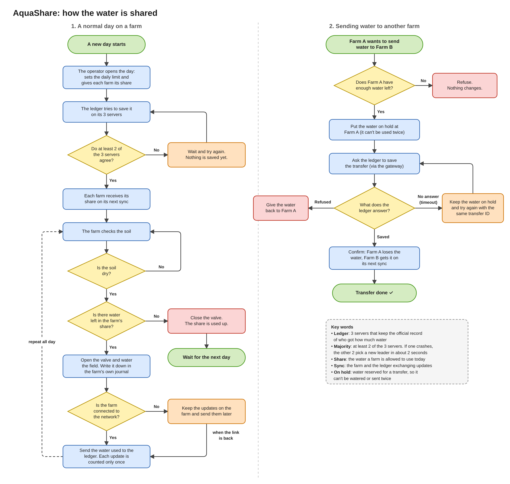

# AquaShare

**Fair water sharing between farms, even when machines crash or the network fails.**

AquaShare is a distributed system that shares the daily water of one reservoir between several farms. The daily limit is never exceeded, even when servers crash, the network splits, or farms lose their connection. It was built as the final project of the Distributed Systems course (Dr. Charbel El Gemayel, Antonine University).



---

## How it works, in four steps

1. **The day opens.** The ledger releases the reservoir's daily water and gives each farm its own share.
2. **Farms irrigate.** Each farm spends only its own share, so it keeps working even without network.
3. **Farms share water.** A farm with spare water can send some of it to another farm (reserve → commit → confirm).
4. **The ledger keeps score.** Every use and transfer is saved on 3 servers that agree with Raft, so nothing is lost or counted twice.

## Architecture

```
 farm-a ─┐                                         ┌─────── Ledger cluster (Raft) ───────┐
 farm-b ─┤                    ┌─ gateway-1 ─┐      │  ledger-1 ── PostgreSQL              │
 farm-c ─┼──► Nginx (8600) ───┤             ├────► │  ledger-2 ── PostgreSQL              │
 farm-d ─┘                    └─ gateway-2 ─┘      │  ledger-3 ── PostgreSQL              │
 (wallet + journal,                                └───────────────┬──────────────────────┘
  works offline)                                                   │ events (outbox relay)
                                                                   ▼
        Web dashboard (8090)        Prometheus + Grafana        RabbitMQ ──► Analytics
```

| Component | What it does |
|---|---|
| **Ledger nodes** (`ledger_node/`) | Our own Raft implementation (gRPC between nodes). A change is committed only when a majority (2 of 3) has written it to disk. Each node has its own PostgreSQL database, and the log is a hash chain. |
| **Farm nodes** (`farm_node/`) | Simulated sensors and valve. An escrow wallet and a local journal let the farm irrigate offline and sync later. |
| **Gateways** (`gateway/`) | Stateless REST entry points. They find the current leader and retry safely, because every command has a unique ID. Two of them run behind an Nginx load balancer. |
| **Event relay + analytics** (`analytics/`) | Committed changes are published to RabbitMQ through an outbox relay; the analytics service consumes them idempotently. |
| **Monitoring** (`monitoring/`) | Prometheus scrapes the ledger nodes and gateways; Grafana shows a ready-made dashboard. |
| **Dashboard** (`dashboard/`) | A web page that shows the whole system in plain words and runs 8 test scenarios with one click. |

## Requirements

- **Docker Desktop** (with Docker Compose)
- **Python 3.12**, only to run the tests and the scripts from your machine

## Quick start

```bash
# 1. Start everything
docker compose up -d --build

# 2. Install the Python packages (for the scripts and tests)
python -m venv .venv
.venv\Scripts\activate            # Windows   (Linux/macOS: source .venv/bin/activate)
pip install -r requirements.txt

# 3. Register the four farms (only the first time)
python scripts/ledger_cli.py register farm-a "Farm A"
python scripts/ledger_cli.py register farm-b "Farm B"
python scripts/ledger_cli.py register farm-c "Farm C"
python scripts/ledger_cli.py register farm-d "Farm D"
```

Then open the dashboard at **http://localhost:8090**, go to the **Demo** tab and click **1. Start a new day**. This opens the next day with 20,000 L: 6,000 / 5,000 / 4,500 / 4,000 L for the four farms.

You can also open a day from the command line:

```bash
python scripts/ledger_cli.py open-day 2026-11-20 20000 farm-a=6000 farm-b=5000 farm-c=4500 farm-d=4000
```

To stop everything: `docker compose down` (add `-v` to also delete all data).

## Services and ports

| Service | URL | Login |
|---|---|---|
| Web dashboard | http://localhost:8090 | |
| Gateway (load balancer) | http://localhost:8600 | |
| Gateways 1 and 2 | http://localhost:8601, http://localhost:8602 | |
| Ledger nodes 1, 2, 3 | http://localhost:8701, 8702, 8703 | |
| Farms a, b, c, d | http://localhost:8801, 8802, 8803, 8804 | |
| Analytics | http://localhost:8901/summary | |
| Grafana | http://localhost:3300 | admin / aquashare |
| Prometheus | http://localhost:9095 | |
| RabbitMQ management | http://localhost:15673 | aquashare / aquashare_dev |
| Ledger databases (PostgreSQL) | localhost:5441, 5442, 5443 | aquashare / aquashare_dev |

The ports were chosen so that AquaShare can run next to other course projects without conflicts.

## The live demo

The **Demo** tab of the dashboard runs eight scenarios, in this order. A live view next to them shows the servers, the farms and the latest records reacting.

| # | Scenario | What it shows |
|---|---|---|
| 1 | Start a new day | The ledger gives each farm a fresh share |
| 2 | A farm goes offline | The farm keeps watering; its updates wait and are sent once each when it reconnects |
| 3 | Same transfer twice | A repeated transfer ID is recognised and changes nothing |
| 4 | Spend too much | The farm's wallet and the ledger both refuse |
| 5 | Crash the leader | A new leader is elected in about 2 seconds |
| 6 | Lose the majority | With 1 server of 3, nothing is saved; a waiting transfer finishes after the restart |
| 7 | Prove a record is real | A Merkle proof verifies a transfer; a falsified copy fails |
| 8 | Check the 7 rules | The invariant checker passes on all 3 databases |

> **Note:** scenarios 5 and 6 stop and start containers, so the dashboard container has access to the Docker socket (`/var/run/docker.sock` in `docker-compose.yml`). This gives it full control of Docker. It is acceptable for a local demo, but must never be done in production.

## Tests and evaluation

Run these from the project folder, with the virtual environment active and the system running.

| Command | What it does |
|---|---|
| `python -m pytest -q` | 67 unit tests (Raft, state machine, wallets, sync, transfers, gateway, analytics, invariants, Merkle proofs) |
| `python scripts/check_invariants.py` | Checks the 7 correctness rules (I1–I7) on the 3 ledger databases |
| `python scripts/partition_test.py` | Cuts the leader off the network and checks it cannot commit, then heals the network |
| `python scripts/chaos_test.py --minutes 3` | Sends traffic while randomly stopping and starting ledger nodes, then checks nothing was lost or doubled |
| `python scripts/benchmark.py` | Measures throughput, response time, the cost of the gateway layer and failover time; writes CSVs and charts to `results/` |
| `python scripts/verify_proof.py --index 5` | Verifies one record with a Merkle proof (add `--tamper` to see a falsified record fail) |
| `python scripts/load_test.py --url http://localhost:8600 --farm farm-c --count 60` | A steady stream of commands, to watch a leader failover |

PowerShell helpers in `scripts/`: `cluster_status.ps1`, `farm_status.ps1`, `compare_balances.ps1`, `compare_analytics.ps1`, `send_transfer.ps1`, `send_command.ps1`.

### Results

| Measure | Result |
|---|---|
| Unit tests | 67 passed |
| Chaos test | 1,317 operations, 17 node crashes (5 losses of majority), 0 lost or doubled, all invariants hold |
| Partition test | Isolated leader could not commit; it rejoined as a follower and all nodes ended with the same history |
| Throughput | 15 ops/s with 1 client, up to 76 ops/s at saturation |
| Median response time | about 62 ms below saturation |
| Errors | 0 in 3,883 operations |
| Leader failover | 1.97 s on average |
| Gateway layer cost | about 11% throughput |

## Main design choices

- **Escrow shares:** the daily limit is split into per-farm shares, so farms stay available offline while the global limit always holds.
- **Raft, written from scratch:** a majority must save every change, and a new leader is elected automatically when one crashes.
- **One database per ledger node:** no single point of failure; each node recovers from its own disk.
- **Unique IDs everywhere:** commands, consumption events and transfers are applied exactly once, even when retried.
- **Days opened by the ledger:** no machine uses its own clock to decide the day.
- **Hash chain + Merkle tree:** any change to the history is detected, and a farm can verify its own record.

The full reasoning and the trade-offs are in the report.

## Project structure

```
ledger_node/   Raft, storage, state machine, Merkle tree, metrics
farm_node/     wallet, journal, sync with the ledger, simulated sensors
gateway/       REST gateway + nginx.conf for the load balancer
analytics/     event relay (outbox → RabbitMQ) and analytics consumer
dashboard/     web dashboard and demo scenarios
monitoring/    Prometheus config and Grafana dashboard
scripts/       CLI, invariant checker, chaos/partition tests, benchmark, proof verifier
tests/         unit tests (pytest)
results/       benchmark CSVs and charts, recorded test runs
docs/          flowchart (PNG + draw.io), presentation
shared/        shared code
```

## Author

Myriam Rahal · Master of Computer & Communication Engineering, Antonine University · Distributed Systems course
